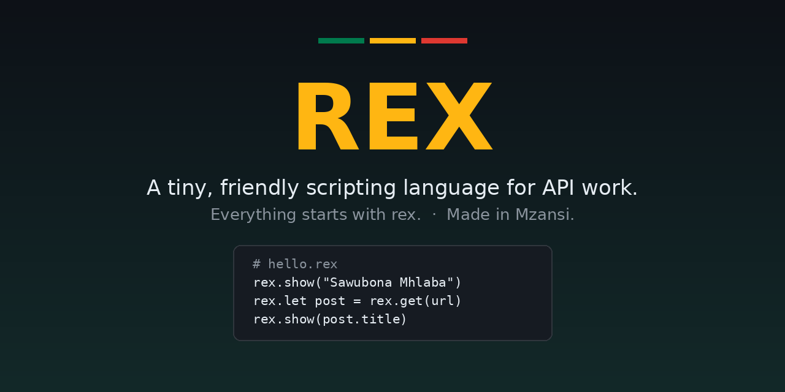
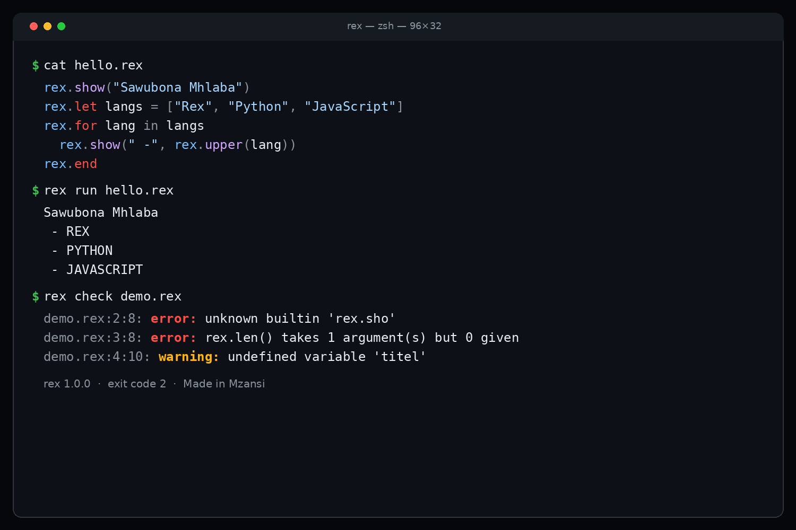

<div align="center">



# Rex

**A tiny, friendly scripting language for API work.** Everything starts with `rex.`
Made in Mzansi. Built for developers who just want to fetch data and print it.

[](https://github.com/alysiumcorporationstudios/Rex-Programming-Lang/actions/workflows/ci.yml)
[](https://alysiumcorporationstudios.github.io/Rex-Programming-Lang/)
[](https://github.com/alysiumcorporationstudios/Rex-Programming-Lang/releases)
[](https://www.python.org/)
[](LICENSE)
[](tests)

[Documentation](https://alysiumcorporationstudios.github.io/Rex-Programming-Lang/) ·
[Quick start](https://alysiumcorporationstudios.github.io/Rex-Programming-Lang/quickstart/) ·
[Language](https://alysiumcorporationstudios.github.io/Rex-Programming-Lang/language/) ·
[Standard library](https://alysiumcorporationstudios.github.io/Rex-Programming-Lang/stdlib/) ·
[Changelog](CHANGELOG.md) ·
[Roadmap](ROADMAP.md)

</div>

---

```rex
rex.show("Sawubona Mhlaba")

rex.let post = rex.get("https://jsonplaceholder.typicode.com/posts/1")
rex.show(post.title)

rex.for tag in ["api", "tiny", "mzansi"]
  rex.show("-", rex.upper(tag))
rex.end
```

Rex is a complete little language, not a wrapper around one: a real lexer, parser
and interpreter with values, control flow, functions, closures, error handling and
an HTTP client that ships in the box.



## Why Rex

- **Namespaced by design.** Every builtin lives under `rex.`, so your names never
  collide with the language and a reader can tell builtin from user code at a
  glance.
- **API-first.** `rex.get`, `rex.post`, `rex.json`, `rex.env` and file helpers are
  built in. No dependency hunting for a throwaway script.
- **One file, one command.** `rex run script.rex`.
- **Honest errors.** File, line, column, a caret under the offending token, and a
  hint that usually tells you exactly what to write instead.
- **A real static checker.** `rex check` catches unknown builtins, wrong argument
  counts and undefined variables before you run anything.
- **Small enough to read.** The interpreter is about 2,500 lines of plain Python,
  standard library plus `requests`.

## Install

```bash
pip install rex-lang
rex run hello.rex
```

From source:

```bash
git clone https://github.com/alysiumcorporationstudios/Rex-Programming-Lang
cd Rex-Programming-Lang
pip install -e ".[dev]"
rex run examples/hello.rex
```

No install at all:

```bash
python -m rex run examples/hello.rex
```

## The language in one screen

```rex
# variables
rex.let name = "Andile"
rex.let year = 2026
rex.show("${name} started Rex in ${year}")

# conditionals
rex.if year >= 2026
  rex.show("the future is now")
rex.elif year >= 2020
  rex.show("getting there")
rex.else
  rex.show("soon")
rex.end

# loops
rex.for n in rex.range(1, 4)
  rex.show("step", n)
rex.end

# functions with defaults, closures and recursion
rex.func greet(who, greeting = "Sawubona")
  rex.return "${greeting}, ${who}!"
rex.end
rex.show(greet("Mhlaba"))

# error handling
rex.try
  rex.let data = rex.get("https://example.com/api")
rex.catch err
  rex.show("request failed:", err.message)
rex.end
```

| Statement | What it does |
|---|---|
| `rex.let x = value` | declare a variable |
| `x = value` | reassign, or assign into `dict.key`, `dict["k"]`, `list[i]` |
| `rex.if` / `rex.elif` / `rex.else` … `rex.end` | branching |
| `rex.while cond` … `rex.end` | loop while true |
| `rex.for item in value` … `rex.end` | loop over a list, string or dict keys |
| `rex.func name(params)` … `rex.end` | define a function |
| `rex.return value` | leave a function (at the top level it ends the script) |
| `rex.try` / `rex.catch err` / `rex.throw` | errors as values |
| `rex.import "lib.rex"` | run another file into the current scope |
| `rex.break`, `rex.continue`, `rex.pass` | loop control |

Values: numbers, strings (with `${}` interpolation), booleans, `null`, lists,
dicts, functions. Operators: `+ - * / %`, `== != < <= > >=`, `and or not` (also
`&& || !`), indexing, member access, calls. Blocks always close with `rex.end`.

## Standard library

60 builtins, all namespaced:

| Group | Highlights |
|---|---|
| HTTP | `rex.get`, `rex.post`, `rex.put`, `rex.patch`, `rex.delete`, `rex.request` |
| JSON | `rex.json.parse`, `rex.json.stringify` |
| Files | `rex.read`, `rex.write`, `rex.append`, `rex.exists`, `rex.list_files` |
| Text | `rex.upper`, `rex.lower`, `rex.trim`, `rex.split`, `rex.join`, `rex.replace`, `rex.contains` |
| Collections | `rex.len`, `rex.push`, `rex.pop`, `rex.sort`, `rex.keys`, `rex.values`, `rex.range`, `rex.unique` |
| Math | `rex.math.sqrt`, `rex.math.round`, `rex.math.min`, `rex.math.max`, `rex.math.random` |
| Time | `rex.time.now`, `rex.time.sleep`, `rex.time.timestamp` |
| System | `rex.env`, `rex.args`, `rex.exit`, `rex.assert`, `rex.type`, `rex.str`, `rex.num` |

The full reference is [generated from the interpreter source](https://alysiumcorporationstudios.github.io/Rex-Programming-Lang/stdlib/),
so it cannot drift from what ships.

## CLI

```bash
rex run script.rex [args...]   # run a program
rex script.rex                 # shorthand
rex repl                       # interactive session
rex check script.rex           # static checks, no execution
rex ast script.rex             # dump the syntax tree as JSON
rex init my-project            # scaffold a project
rex version
```

```
$ rex check demo.rex
demo.rex:2:8: error: unknown builtin 'rex.sho'
demo.rex:3:8: error: rex.len() takes 1 argument(s) but 0 given
demo.rex:4:10: warning: undefined variable 'titel'
```

Exit codes: `0` success, `1` runtime error, `2` syntax or check error, `3` usage,
`4` missing file, `130` interrupted. Runaway loops and recursion are bounded by
`--max-steps` and `--max-depth`.

## Examples

Fourteen runnable programs in [`examples/`](examples): hello world, control flow,
functions and closures, collections, strings, JSON, files, errors, environment and
arguments, HTTP fetch, full CRUD, fizzbuzz and a small word-count report.

```bash
make examples
```

## Documentation

The full manual lives at
**[alysiumcorporationstudios.github.io/Rex-Programming-Lang](https://alysiumcorporationstudios.github.io/Rex-Programming-Lang/)**:
quick start, language reference, standard library, CLI, examples, the formal
[specification](docs/spec.md) and [architecture](ARCHITECTURE.md).

## Project layout

```
rex/            the interpreter
  lexer.py        source → tokens
  parser.py       tokens → AST
  ast_nodes.py    AST node definitions
  interpreter.py  tree-walking runtime
  builtins.py     the rex.* standard library
  analyzer.py     static checks for `rex check`
  cli.py, repl.py command line and REPL
  errors.py       diagnostics
tests/          203 tests (lexer, parser, runtime, stdlib, CLI, analyzer, examples)
examples/       14 runnable .rex programs
docs/           the documentation site (MkDocs Material)
editors/vscode/ VS Code extension: syntax highlighting and snippets
scripts/        docs and asset generators
```

## Quality

```bash
make test    # pytest — 205 passing
make lint    # ruff — clean
make check   # rex check on every example
make docs    # serve the documentation locally
```

CI runs the tests on Python 3.8 through 3.13, lints, static-checks every example,
verifies the generated docs are current, and builds a wheel.

## Contributing

Issues and pull requests are welcome. Start with [CONTRIBUTING.md](CONTRIBUTING.md),
be decent ([code of conduct](CODE_OF_CONDUCT.md)), and read
[ARCHITECTURE.md](ARCHITECTURE.md) before adding a builtin or a statement.
Security reports: [SECURITY.md](SECURITY.md).

## License

MIT © 2026 Andile Mtolo (Toxic Dee Modder) / Alysium Corp Studios ZA inc.
See [LICENSE](LICENSE).

---

<div align="center">

**Made in Mzansi** 🇿🇦 · Founded in South Africa by Alysium Corp Studios

</div>
